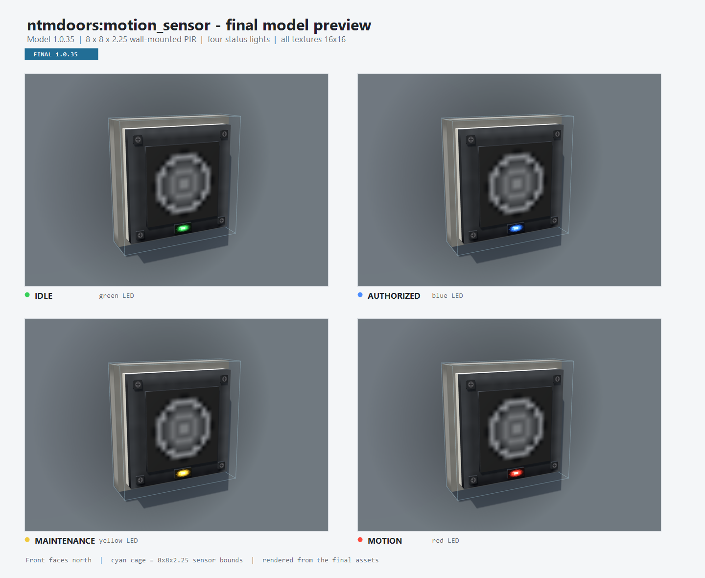

# Motion Sensor source art

Final model and texture source materials for the NTM Doors Motion Sensor (model 1.0.36).



These files are archived here for reference. The active copies loaded by the mod live under
`src/main/resources/assets/ntmdoors/`. The generators below write directly to that folder; no
duplicate asset tree is kept here.

## Model

- Footprint: 8 x 8 texture pixels
- Depth: 1.375 texture pixels
- Front: north in model space
- Back plate: z=15..16
- Blocks: `motion_sensor`, with six-way facing and four status models
- Item model: `motion_sensor_item.json` is the centred GUI copy

## Textures

All textures are 16x16:

- `sensor_body.png`
- `sensor_plate.png`
- `sensor_bezel.png`
- `sensor_lens.png`
- `sensor_screw.png`
- `sensor_led_green.png`
- `sensor_led_blue.png`
- `sensor_led_yellow.png`
- `sensor_led_red.png`

Status mapping: idle green, authorised blue, maintenance yellow, motion red.

## Rebuilding

Run the PowerShell generator to rebuild every texture exactly:

```powershell
powershell -ExecutionPolicy Bypass -File scripts\generate_motion_sensor_textures.ps1
powershell -ExecutionPolicy Bypass -File scripts\generate_motion_sensor_preview.ps1
```
